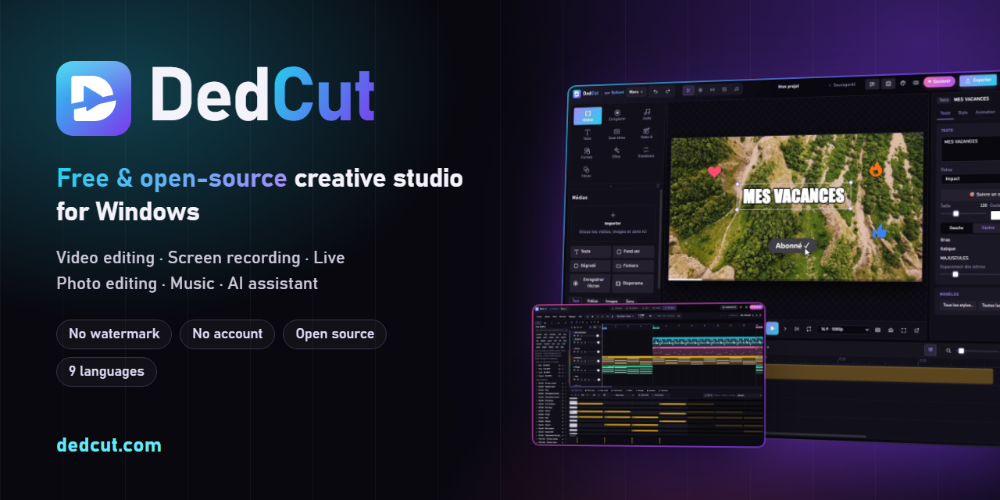

<p align="center"></p>

<p align="center">
  <a href="https://github.com/Bykemi/DedCut-mises-a-jour/releases/latest"></a>
  <a href="LICENSE"></a>
  
  
  
</p>

<p align="center">
  <b><a href="https://github.com/Bykemi/DedCut-mises-a-jour/releases/latest/download/DedCut-Installation.exe">Télécharger pour Windows</a></b> ·
  <a href="https://dedcut.com">dedcut.com</a> ·
  <a href="https://dedcut.com/tutos.html">Tutos</a> ·
  <a href="https://x.com/DedCutt">X @DedCutt</a> ·
  <a href="#english">English</a>
</p>

# DedCut

Logiciel de création **gratuit** et **libre** pour Windows, fait par **ByKemi** : montage vidéo, enregistrement d'écran,
live, retouche photo et musique, avec un assistant IA. Tout se passe sur ton PC : pas de compte, pas de pub,
pas de filigrane, pas de télémétrie.

DedCut est en **bêta** : tout marche, mais il peut rester des bugs. Pour en signaler un : clique sur la pastille
« bêta » dans DedCut (ou Menu > Signaler un bug), ou écris à bugs@dedcut.com.

## Cinq espaces dans un seul logiciel

| | |
|---|---|
| **Montage** | Timeline multipiste, sous-titres automatiques faits sur le PC, montage en effaçant des mots, Shorts automatiques, multicam, suivi d'objet et flou qui suit, stabilisation, 225 effets, 189 filtres, 82 transitions, export jusqu'à la 4K, vertical ou GIF |
| **Enregistrer** | Écran, jeu, son du PC, micro et webcam avec scènes et sources (comme OBS), fond flou ou retiré sans fond vert, voix du micro modifiée en direct |
| **Live** | YouTube, Twitch, Facebook, Kick et TikTok en même temps, studio vertical 9:16, chat et alertes à l'écran, habillages animés, télécommande sur téléphone |
| **Image** | Calques, masques, textes et formes, détourage automatique, fichiers PSD et TIFF, tablettes graphiques avec pression, modèles de miniatures, QR code |
| **Musique** | Beats pas à pas et piano roll, instruments et sons libres de droits, voix, accordeur, correction de la justesse, chœurs automatiques, export WAV, FLAC, M4A et pistes séparées |

Et partout : **DedCut IA**, un assistant intégré, gratuit et sans internet, qui monte à ta place et répond à tes questions.

<p align="center">
  
  
</p>
<p align="center">
  
  
</p>

## Soutenir DedCut

DedCut est et restera gratuit. Si tu veux aider ByKemi à continuer, tu peux faire un don :
**https://paypal.me/DedCut** — c'est facultatif et ça ne débloque rien : toutes les fonctions sont pour tout le monde.
Mettre une **étoile** au projet sur GitHub aide aussi beaucoup à le faire connaître.

## Licence

Le code de DedCut est un **logiciel libre**, sous licence **GNU GPL version 3 ou ultérieure** (fichier [LICENSE](LICENSE)).
Tu peux l'étudier, le modifier et le partager, à condition que toute version partagée reste libre : même licence,
avec son code source.

- Les composants d'autres auteurs gardent leur propre licence : voir [tauri/THIRD_PARTY_LICENSES.md](tauri/THIRD_PARTY_LICENSES.md)
  et [tauri/LICENCES-TIERS.txt](tauri/LICENCES-TIERS.txt).
- Le **nom « DedCut »** et le **logo DedCut** appartiennent à ByKemi et ne sont pas couverts par la licence :
  une version modifiée doit porter un autre nom et un autre logo.
- Les mises à jour automatiques sont **signées par ByKemi** : une version fabriquée par quelqu'un d'autre ne peut pas
  se faire passer pour une mise à jour officielle.

## Fabriquer DedCut

Il faut Windows 10 ou 11, [Node.js](https://nodejs.org) 20 ou plus récent et [Rust](https://rustup.rs) (stable).

```
cd tauri
npm install
npm run tauri dev
```

Pour fabriquer un installateur sans la clé de signature des mises à jour (réservée à ByKemi) :

```
npx tauri build --config "{\"bundle\":{\"createUpdaterArtifacts\":false}}"
```

Le code de l'interface est dans `tauri/src` (React) et `tauri/public/engine` (moteur de l'éditeur), la partie Windows
dans `tauri/src-tauri` (Rust). Les textes des 9 langues sont dans `tauri/public/locales`.

Envie d'aider ? Lis [CONTRIBUTING.md](CONTRIBUTING.md).

---

<a id="english"></a>
## English

**DedCut** is a **free** and **open-source** creative app for Windows by **ByKemi**: video editing, screen recording,
live streaming, photo editing and music, with an AI assistant. Everything runs on your PC: no account, no ads,
no watermark, no telemetry. Available in 9 languages. Currently in **beta** — report bugs with the “beta” badge
in the app or at bugs@dedcut.com.

- **Edit**: multitrack timeline, automatic on-device subtitles, edit by deleting words, automatic Shorts, multicam,
  object tracking, stabilisation, 225 effects, 189 filters, 82 transitions, export up to 4K, vertical or GIF.
- **Record**: screen, game, PC sound, mic and webcam with scenes and sources (like OBS), background removal without green screen.
- **Live**: YouTube, Twitch, Facebook, Kick and TikTok at the same time, vertical 9:16 studio, on-screen chat and alerts.
- **Image**: layers, masks, text, automatic background removal, PSD and TIFF, pressure-sensitive tablets, thumbnail templates.
- **Music**: step beats, piano roll, royalty-free instruments, vocals, tuner, pitch correction, automatic backing vocals.

**Download:** https://github.com/Bykemi/DedCut-mises-a-jour/releases/latest — **Website:** https://dedcut.com/en/ — **X:** https://x.com/DedCutt

The source code is **free software** under the **GNU GPL version 3 or later** (see [LICENSE](LICENSE)). Third-party
components keep their own licences (see `tauri/THIRD_PARTY_LICENSES.md`). The **DedCut name and logo** belong to ByKemi
and are not covered by the licence: a modified version must use another name and logo. Automatic updates are signed by ByKemi.

Build: Windows 10/11, Node.js 20+, Rust stable — `cd tauri`, `npm install`, `npm run tauri dev`.
Want to help? Read [CONTRIBUTING.md](CONTRIBUTING.md). DedCut is and will stay free; optional donations:
**https://paypal.me/DedCut** (unlocks nothing). A **star** on GitHub helps a lot too.
