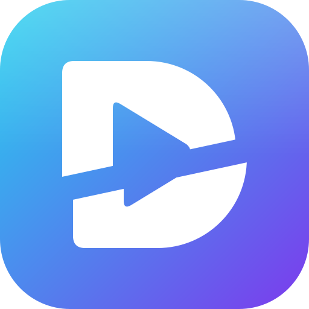
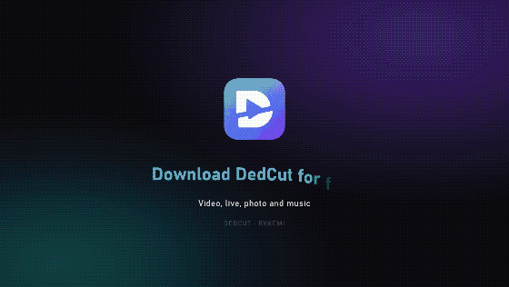
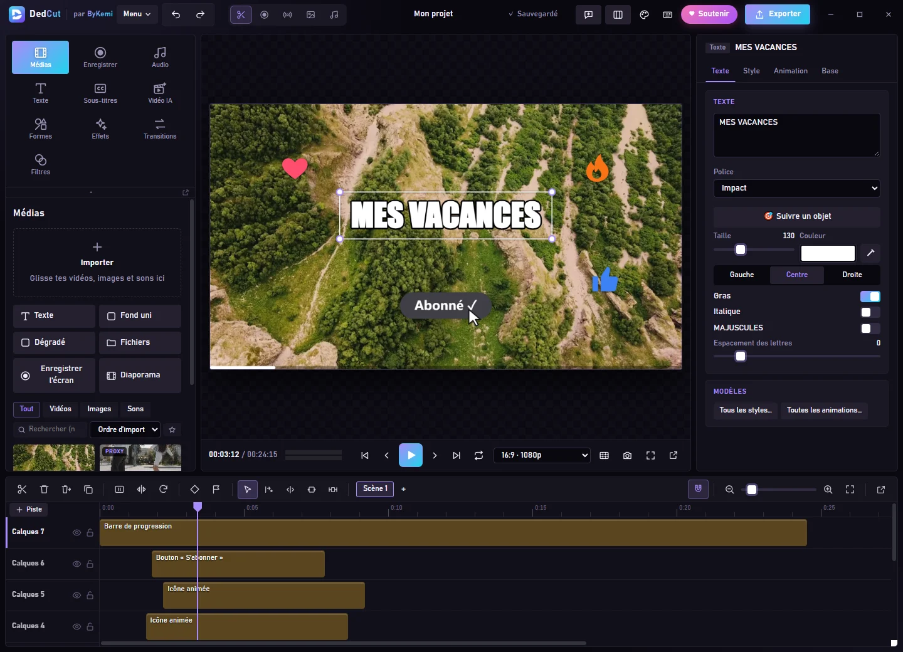
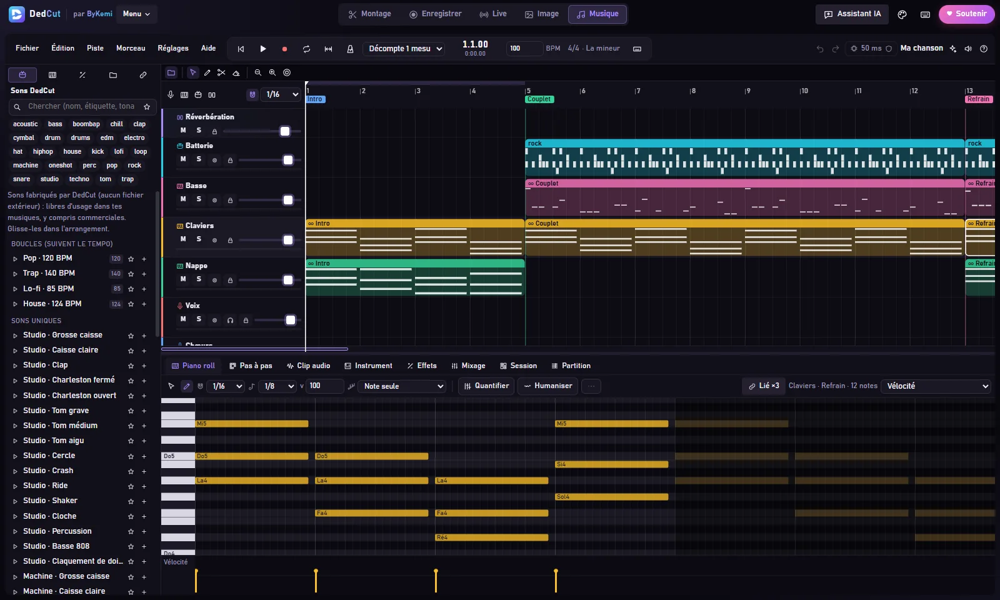
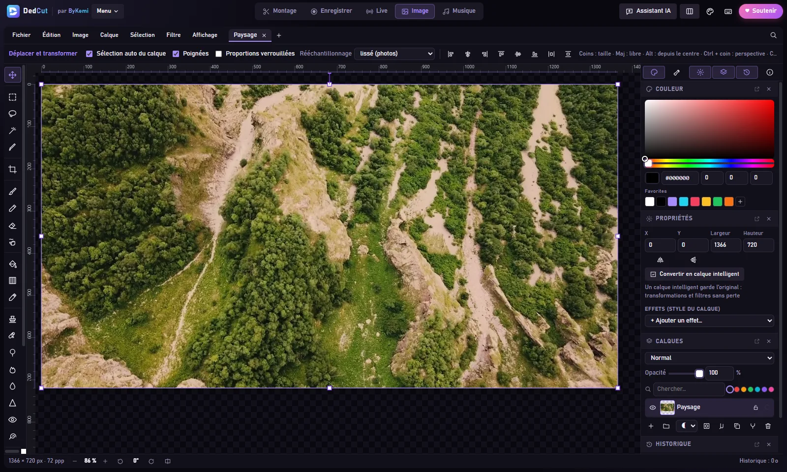
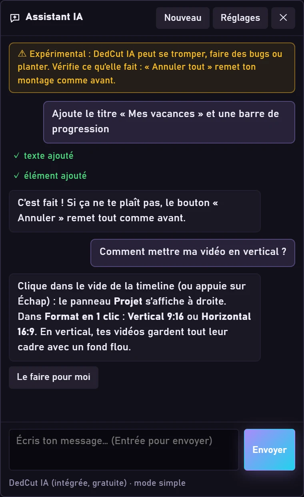

<p align="center"></p>

<h1 align="center">DedCut</h1>

<p align="center">
  <b>A free, open-source alternative to CapCut, OBS and Photoshop — in one app.</b><br>
  Edit videos, record your screen, go live, retouch photos and make music, with an AI assistant that runs offline.<br>
  No account, no ads, no watermark. Everything stays on your PC.
</p>

<p align="center">
  <a href="https://github.com/Bykemi/DedCut-mises-a-jour/releases/latest"></a>
  <a href="LICENSE"></a>
  
  
  
</p>

<p align="center">
  <b><a href="https://github.com/Bykemi/DedCut-mises-a-jour/releases/latest/download/DedCut-Installation.exe">Download for Windows</a></b> ·
  <a href="https://dedcut.com/en/">dedcut.com</a> ·
  <a href="https://dedcut.com/en/tutos.html">Tutorials</a> ·
  <a href="https://x.com/DedCutt">X @DedCutt</a> ·
  <a href="#français">Français</a>
</p>

<p align="center"></p>

DedCut is in **beta**: everything works, but some bugs may remain. Found one? Click the “beta” badge inside DedCut
(or Menu > Report a bug), or write to bugs@dedcut.com.

## Five spaces in one app

| | |
|---|---|
| **Edit** | Multitrack timeline, automatic subtitles made on your PC, edit by deleting words in the transcript, automatic Shorts, multicam, object tracking and moving blur, stabilisation, 225 effects, 189 filters, 82 transitions, export up to 4K, vertical or GIF |
| **Record** | Screen, game, PC sound, mic and webcam with scenes and sources (like OBS), background blur or removal without a green screen, live voice effects for your mic |
| **Live** | YouTube, Twitch, Facebook, Kick and TikTok at the same time, vertical 9:16 studio, chat and alerts on screen, animated overlays, phone remote control |
| **Image** | Layers, masks, text and shapes, automatic background removal, PSD and TIFF files, pressure-sensitive graphics tablets, thumbnail templates, QR codes |
| **Music** | Step beats and piano roll, royalty-free instruments and sounds, vocals, tuner, pitch correction, automatic backing vocals, export to WAV, FLAC, M4A and stems |

And everywhere: **DedCut AI**, a built-in assistant that works offline and for free — it edits for you and answers your questions.

<p align="center">
  
  
</p>
<p align="center">
  
  
</p>

## Why DedCut

- **One app instead of five.** Record, edit, make the thumbnail, add music, cut Shorts and go live without juggling tools: your recordings land in the editor by themselves, and images and sounds move between spaces.
- **Free forever, private by design.** No subscription, no paid features, no telemetry. Subtitles, background removal and the AI assistant run on your PC — no video is ever uploaded.
- **Made for everyone.** A simple mode, an AI that does the editing for beginners, and 43 step-by-step tutorials in 9 languages.

## Support DedCut

DedCut is and will stay free. If you want to help ByKemi keep going: **https://paypal.me/DedCut** — optional, it unlocks
nothing. A **star** on this repository helps a lot too.

## License

The source code of DedCut is **free software** under the **GNU GPL version 3 or later** (see [LICENSE](LICENSE)).
You can study, change and share it, as long as every shared version stays free, under the same licence, with its source code.

- Third-party components keep their own licences: see [tauri/THIRD_PARTY_LICENSES.md](tauri/THIRD_PARTY_LICENSES.md)
  and [tauri/LICENCES-TIERS.txt](tauri/LICENCES-TIERS.txt).
- The **DedCut name** and the **DedCut logo** belong to ByKemi and are not covered by the licence:
  a modified version must use another name and logo.
- Automatic updates are **signed by ByKemi**: a build made by someone else cannot pass itself off as an official update.

## Build DedCut

You need Windows 10 or 11, [Node.js](https://nodejs.org) 20 or newer and [Rust](https://rustup.rs) (stable).

```
cd tauri
npm install
npm run tauri dev
```

To build an installer without the update signing key (reserved to ByKemi):

```
npx tauri build --config "{\"bundle\":{\"createUpdaterArtifacts\":false}}"
```

The interface lives in `tauri/src` (React) and `tauri/public/engine` (the editor engine), the Windows side in
`tauri/src-tauri` (Rust, [Tauri 2](https://tauri.app)). The texts of the 9 languages are in `tauri/public/locales`.

Want to help? Read [CONTRIBUTING.md](CONTRIBUTING.md).

---

<a id="français"></a>
## Français

**DedCut** est un logiciel de création **gratuit** et **libre** pour Windows, fait par **ByKemi** : montage vidéo,
enregistrement d'écran, live, retouche photo et musique, avec un assistant IA qui marche sans internet.
Pas de compte, pas de pub, pas de filigrane : tout se passe sur ton PC. Traduit en 9 langues. En **bêta** : pour
signaler un bug, clique sur la pastille « bêta » dans DedCut (ou Menu > Signaler un bug), ou écris à bugs@dedcut.com.

- **Montage** : timeline multipiste, sous-titres automatiques faits sur le PC, montage en effaçant des mots, Shorts
  automatiques, multicam, suivi d'objet, stabilisation, 225 effets, export jusqu'à la 4K, vertical ou GIF.
- **Enregistrer** : écran, jeu, son du PC, micro et webcam avec scènes et sources (comme OBS), fond retiré sans fond vert.
- **Live** : YouTube, Twitch, Facebook, Kick et TikTok en même temps, studio vertical 9:16, chat et alertes à l'écran.
- **Image** : calques, masques, détourage automatique, fichiers PSD et TIFF, tablettes graphiques, modèles de miniatures.
- **Musique** : beats, piano roll, instruments libres de droits, voix, accordeur, justesse, chœurs automatiques.

**Télécharger :** https://github.com/Bykemi/DedCut-mises-a-jour/releases/latest — **Site :** https://dedcut.com —
**Tutos :** https://dedcut.com/tutos.html — **X :** https://x.com/DedCutt

Le code est un **logiciel libre** sous licence **GNU GPL version 3 ou ultérieure** ([LICENSE](LICENSE)). Les composants
d'autres auteurs gardent leur licence. Le **nom** et le **logo DedCut** appartiennent à ByKemi : une version modifiée doit
porter un autre nom et un autre logo. Les mises à jour automatiques sont signées par ByKemi.

Pour le fabriquer : Windows 10 ou 11, Node.js 20+, Rust stable — `cd tauri`, `npm install`, `npm run tauri dev`.
Envie d'aider ? Lis [CONTRIBUTING.md](CONTRIBUTING.md). DedCut est et restera gratuit ; dons facultatifs :
**https://paypal.me/DedCut** (ça ne débloque rien). Une **étoile** sur GitHub aide aussi beaucoup.
